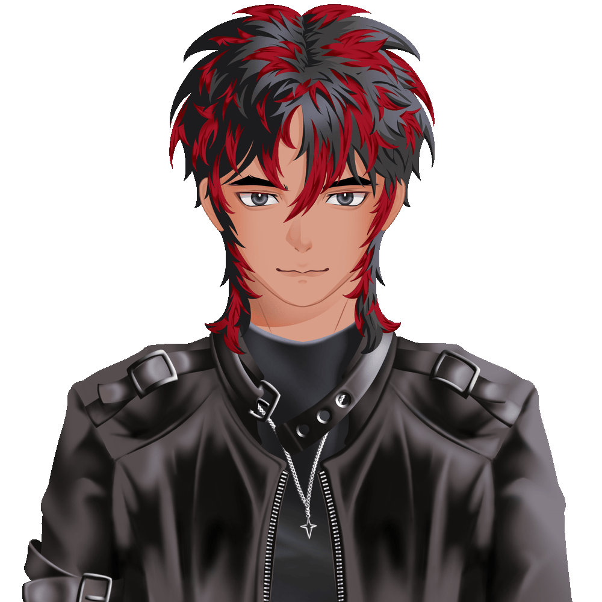

<div align="center">

# Hey, I'm Rel

### Student by day, frontend enthusiast by choice, bug creator by accident.

[](https://rvykcode.vercel.app/)
[](https://instagram.com/afrlzhm)

</div>

---

<table>
<tr>
<td width="240">
  
</td>
<td>

## About me

- Student who spends too much time building websites
- Currently focused on frontend development
- Mostly working with Next.js and modern frontend tools
- Turning random ideas into questionable interfaces
- Check out my latest portfolio: [rvykcode.vercel.app](https://rvykcode.vercel.app/)

</td>
</tr>
</table>

> *Créer, c’est vivre deux fois.*

---

## Tech stack

<p align="center">
  
</p>

---

## GitHub stats

<div align="center">


<br/>


</div>

---

## Currently

```txt
learning frontend
building random things
fixing CSS at 3 AM
pretending everything is intentional
```

<div align="center">

### Thanks for stopping by. Please don't judge the commit history.

</div>
